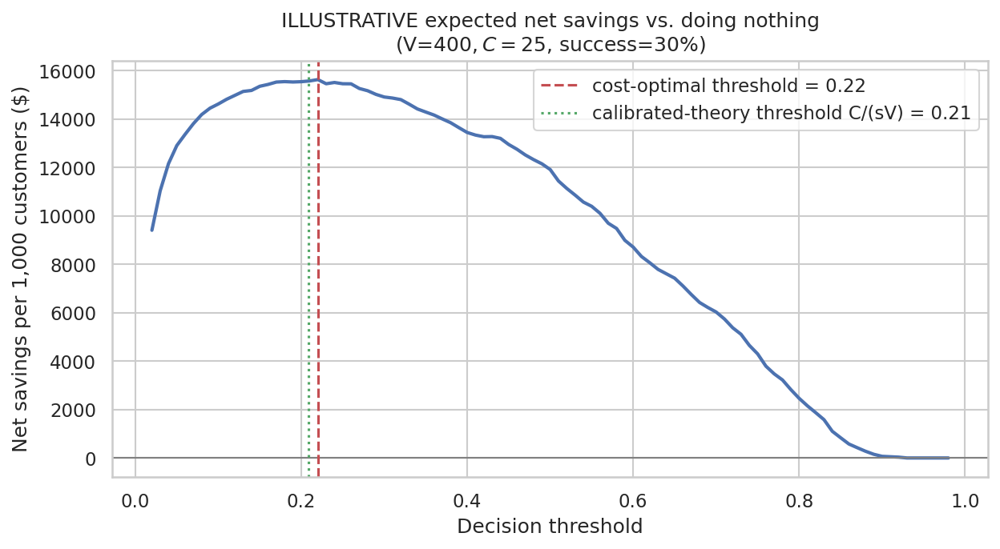
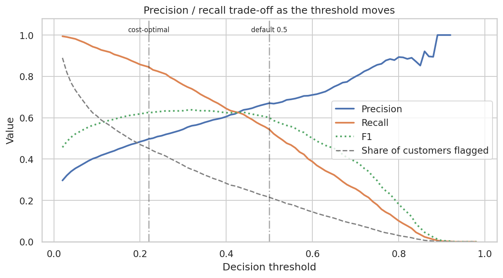
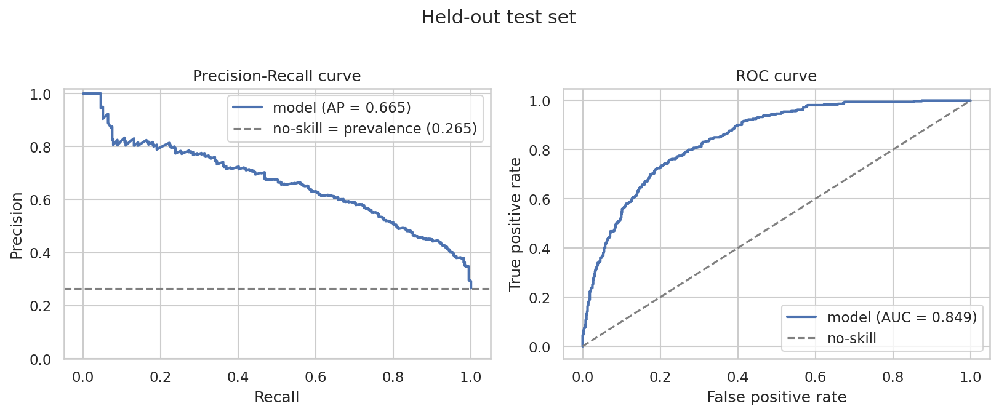
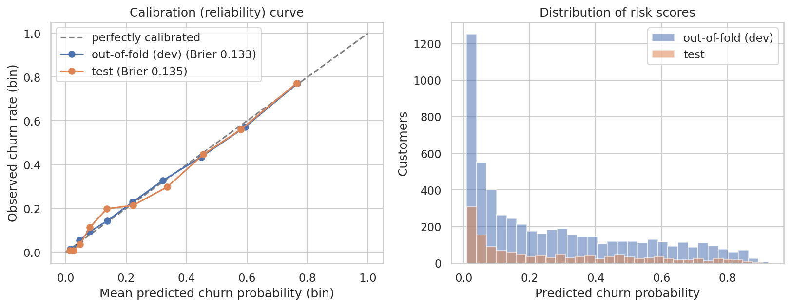
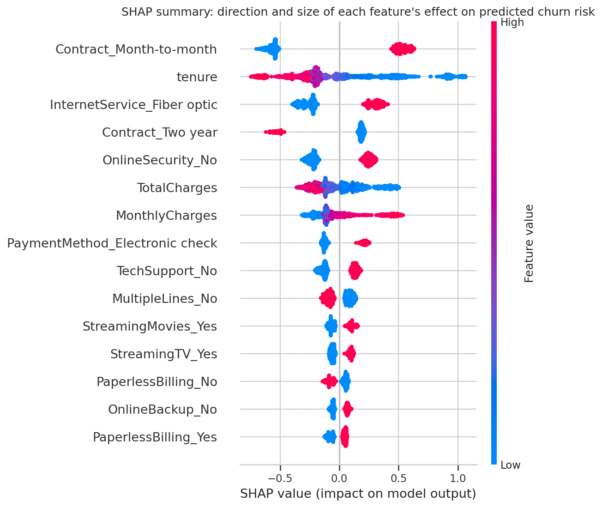

# Customer Churn Prediction and Risk Analysis

An end-to-end, leakage-safe machine-learning project on the IBM Telco Customer Churn dataset: exploratory analysis with statistical testing, a
model comparison with nested cross-validation, calibrated churn risk scores, a **cost-based decision threshold**, SHAP explanations, a reusable prediction
function and a Streamlit dashboard.

> **Design principle:** correctness and honesty over impressive numbers. Performance is moderate (ROC-AUC about 0.85), evaluated on a held-out test set that was
> scored once, with confidence intervals. Nothing is tuned on the test set, and illustrative business assumptions are labelled as such.

## 1. Project overview
| | |
|---|---|
| Task | Binary classification: will a customer churn? |
| Data | 7,043 customers x 21 columns (IBM Telco sample data) |
| Split | 80% development (5,634) / 20% held-out test (1,409), stratified, seed 42 |
| Models compared | Dummy baseline, Logistic Regression, Random Forest, XGBoost, LightGBM |
| Selected model | LightGBM (small edge over the others - see section 12) |
| Test ROC-AUC / PR-AUC | 0.849 / 0.665 (no-skill PR-AUC = 0.265) |

## 2. Business problem
A telecom operator loses about a quarter of its customers in the observation window. Retention offers cost money and not every customer would have left. The questions are:
*who is at risk, what characterises them, and how many customers should we contact?* The last question is a **decision** that depends on costs, which is why the project
treats the classification threshold separately from the model.

## 3. Dataset source
* **IBM Telco Customer Churn** sample dataset, from IBM's public repository: <https://github.com/IBM/telco-customer-churn-on-icp4d> (also mirrored on Kaggle).
* One row per customer; target `Churn` (customer left in the last month, per IBM's description).
* **Limitations:** a sample dataset for a *fictional* company; a single snapshot with no dates (no time-based validation); `tenure` and `TotalCharges` of churned customers are measured up to the point they left;
  22 rows are identical apart from ID (kept - different customers); 11 blank `TotalCharges` values all belong to `tenure == 0` customers (set to 0).
  Results do **not** transfer to a real operator.

## 4. Objectives
Understand churn patterns; compare models honestly; evaluate with precision/recall/PR-AUC/calibration; show how thresholds change business decisions; explain predictions with SHAP; provide customer-level risk scores.

## 5. Technology stack
Python, pandas, NumPy, Matplotlib, Seaborn, SciPy, scikit-learn, XGBoost, LightGBM, SHAP, Jupyter, Streamlit, pytest.

## 6. Repository structure
```
customer-churn-prediction/
├── data/raw/                  # place the downloaded CSV here (git-ignored)
├── data/processed/            # train.csv, test.csv, oof_predictions.csv (generated)
├── notebooks/                 # 01-06, already executed (outputs visible on GitHub)
├── src/
│   ├── config.py              # paths, seed, column groups, ILLUSTRATIVE cost assumptions
│   ├── data_preprocessing.py  # load/validate/clean, stratified split, ColumnTransformer + Pipeline
│   ├── feature_engineering.py # stateless engineered features (tested; not adopted - see notebook 03)
│   ├── train.py               # CV comparison, nested CV tuning, model selection, OOF predictions, threshold, final fit
│   ├── evaluate.py            # metrics, threshold table, cost framework, calibration, bootstrap CIs, report writer
│   ├── explain.py             # SHAP (global + local)
│   └── predict.py             # validated prediction function / CLI
├── models/                    # churn_model.joblib (fitted pipeline), model_metadata.json
├── reports/                   # model_evaluation.md (generated), CSV results, figures/
├── docs/INTERVIEW_GUIDE.md    # 30 interview Q&As;  docs/RESUME_AND_PUBLISHING.md
├── tests/test_pipeline.py     # 12 unit tests (leakage, cost maths, selection rule, validation)
├── app.py                     # Streamlit dashboard
└── requirements.txt
```

## 7. Installation
Requires Python 3.11+ (developed on 3.12).
```bash
git clone <https://github.com/aadarshdixit100-ops/Customer-Churn-Prediction.git> && cd customer-churn-prediction
python -m venv .venv && source .venv/bin/activate      # Windows: .venv\Scripts\activate
pip install -r requirements.txt
```

## 8. Get the data
Either let the project download it:
```bash
python -m src.data_preprocessing --download
```
or download manually from
`https://raw.githubusercontent.com/IBM/telco-customer-churn-on-icp4d/master/data/Telco-Customer-Churn.csv`
and save it as **`data/raw/WA_Fn-UseC_-Telco-Customer-Churn.csv`**.

## 9. Run the pipeline (in this order)
```bash
python -m src.data_preprocessing   # clean + stratified split  -> data/processed/
python -m src.train                # CV, nested-CV tuning, selection, threshold, final model (several minutes on one CPU core)
python -m src.evaluate             # ONE-TIME test evaluation -> reports/model_evaluation.md, figures, customer_risk_scores.csv
python -m src.explain              # SHAP figures and tables
pytest -q                          # unit tests
```
Notebooks (`jupyter lab`) are numbered 01-06 and are best run in order **after** the scripts above; notebook 05 re-runs the (deterministic) test evaluation.
Predict from the command line:
```bash
python -m src.predict --json '{"tenure": 3, "MonthlyCharges": 80.5, "gender": "Male", ...all 18 fields...}'
python -m src.predict --csv customers.csv --output scored.csv
```

## 10. Training and evaluation methodology
1. **Split first**, stratified, then everything below uses the development set only; the test set is scored once at the end.
2. **One scikit-learn `Pipeline`** per model: feature step -> `ColumnTransformer` (median-impute + scale numeric for Logistic Regression only; mode-impute + one-hot categorical) -> classifier. All fitted steps are refit inside every CV fold.
3. **Imbalance (26.5% churn):** no SMOTE/resampling - it distorts probabilities that the cost analysis needs; the threshold handles the precision/recall trade-off (class weighting was tested and rejected: no ranking gain, worse Brier).
4. **Selection:** stratified 5-fold CV for defaults, then **nested CV** (3-fold random search inside 5 outer folds) for tuned models. Rule fixed in advance: highest mean PR-AUC; among models within one standard error, choose the simplest.
5. **Feature engineering was tested, not assumed:** three engineered features changed CV PR-AUC by between -0.002 and +0.004 depending on the model (well inside the ~0.02 fold-to-fold noise) -> the simpler `base` set is used.
6. **Metrics:** accuracy, precision, recall, F1, ROC-AUC, PR-AUC, Brier score, confusion matrix, calibration curve; bootstrap 95% CIs on the test set.

## 11. Threshold optimization methodology (illustrative costs)
The classifier outputs probabilities; flagging a customer is a decision. With **assumed** (not measured) values - customer value V = $400, action cost C = $25 per flagged customer, success probability s = 30% - the expected cost is
`FN*V + TP*(C + (1-s)*V) + FP*C`. If probabilities are calibrated, flagging pays when `p > C/(sV) = 0.21`.
The threshold was chosen on **out-of-fold development predictions** by minimising this cost -> **0.22**, matching the theoretical value. The cost curve is flat near the optimum (0.15-0.26 within 2%), and a sensitivity grid shows the optimum moves between 0.05 and 0.93 as assumptions change.
Threshold selection changes decisions only; **ROC-AUC and PR-AUC are unaffected**.




## 12. Actual results

### Model comparison (development set, nested CV, mean +/- std over 5 folds)
| Model | PR-AUC | ROC-AUC | Brier |
|---|---|---|---|
| Dummy baseline | 0.265 | 0.500 | 0.195 |
| Logistic Regression | 0.660 +/- 0.019 | 0.846 | 0.135 |
| Random Forest | 0.660 +/- 0.024 | 0.847 | 0.135 |
| XGBoost | 0.668 +/- 0.022 | 0.849 | 0.134 |
| **LightGBM (selected)** | **0.673 +/- 0.023** | 0.850 | 0.133 |

All real models are clearly better than the baseline but **close to each other**: LightGBM beats Logistic Regression in 5/5 outer folds by about +0.012 PR-AUC, smaller than the fold-to-fold spread. Default (untuned) LightGBM and Random Forest overfit (training PR-AUC about 0.84-0.85 vs 0.65 validation) until regularised.

### Held-out test set (1,409 customers, 374 churners; scored once)
| Metric | Chosen threshold 0.22 | Default 0.50 | Dummy baseline |
|---|---|---|---|
| Precision | 0.487 | 0.660 | 0.000 |
| Recall | 0.832 | 0.519 | 0.000 |
| F1 | 0.615 | 0.581 | 0.000 |
| Accuracy | 0.723 | 0.801 | 0.735 |
| Customers flagged | 45.3% | 20.9% | 0% |
| ROC-AUC | 0.849 (95% CI 0.827-0.870) | same | 0.500 |
| PR-AUC | 0.665 (95% CI 0.612-0.713) | same | 0.265 |
| Brier score | 0.135 (95% CI 0.124-0.144) | same | 0.195 |

Confusion matrix at 0.22: TP 311, FP 327, TN 708, FN 63. Test results agree with cross-validation (PR-AUC 0.67). **Roughly half of the customers flagged do not churn** - an honest ceiling for these features.
Probabilities are reasonably calibrated (out-of-fold and test).

**Illustrative business view (assumptions, not measurements):** under the assumed costs the framework estimates net savings of about $15,200 per 1,000 customers at threshold 0.22 vs $11,300 at 0.50 and $6,900 for contacting everyone (95% bootstrap interval for the 0.22 figure: about $12,800-$17,400). These are model-based expectations, **not measured retention gains.**




Full generated report: [`reports/model_evaluation.md`](reports/model_evaluation.md).

### What the data shows (observational associations, not causal effects)
* Month-to-month contracts churn at 42.7% vs 11.1% (1-year) and 2.9% (2-year); the gap persists within tenure bands.
* Risk falls steadily with tenure (52% in months 0-6, 6.8% beyond 5 years).
* Fiber-optic customers churn at 42% vs 19% for DSL; the apparent "higher bills -> more churn" pattern is confounded by internet-service type.
* Electronic-check payment, no tech-support / online-security, senior citizens, paperless billing and no partner/dependents are also associated with higher churn. Gender shows no association.

## 13. SHAP explanations
`TreeExplainer` on the final LightGBM, computed on the held-out test customers (additivity verified to floating-point precision). Most influential features by mean |SHAP|: **Contract, tenure, InternetService, OnlineSecurity, TotalCharges, MonthlyCharges, PaymentMethod, TechSupport**. Month-to-month contracts, fiber optic, no security/support, electronic check and short tenure raise predicted risk; two-year contracts and long tenure lower it. A Logistic Regression comparison gives a broadly similar ranking (Spearman 0.87). Local waterfall plots for five real customers (highest risk, lowest risk, near-threshold, a missed churner, a false alarm) are in `reports/figures/`.
**SHAP shows what the model relies on, not what would cause a customer to stay.**



## 14. Dashboard
```bash
streamlit run app.py
```
Tabs: data overview, model performance (test metrics, confusion matrices), threshold and costs (adjust the illustrative assumptions live), SHAP, and a customer scoring form that calls the saved pipeline. Requires the pipeline to have been run (it explains what is missing if not).

## 15. Troubleshooting
| Problem | Fix |
|---|---|
| `FileNotFoundError: Raw data not found` | Download the CSV (section 8). |
| `... not found. Run python -m src.train first` | Run the scripts in the order of section 9. |
| Dashboard says files are missing | Same - the dashboard reads artifacts the pipeline creates. |
| `ModuleNotFoundError: src` in a notebook | Start Jupyter from the repository root, or keep notebooks in `notebooks/` (the first cell adds the root to `sys.path`). |
| Pickle/version warnings loading the model | Use the versions in `requirements.txt`, or re-run `python -m src.train`. |
| Training seems slow | Normal on one core (about 10 minutes, mostly Random Forest nested CV). Use `python -m src.train --quick` for a smoke test only; it does not give meaningful results. |
| Slightly different numbers | Different library versions/hardware can change the last digits; the conclusions should not change. |

## 16. Limitations
* Sample dataset from a fictional company; single snapshot; random split; no temporal validation or drift check, so the test estimate may be optimistic for the future.
* Observational labels - associations, not causal effects; confounding (e.g. fiber vs price, contract vs loyalty) is only partly addressed.
* Cost figures are assumptions; the framework shows *how* to decide, not the true savings.
* Moderate predictive ceiling (precision about 49% at the chosen threshold); models differ by less than the CV noise.
* Fairness only checked descriptively (gender, senior citizen); using such attributes for targeting needs policy/legal review.
* Hyper-parameter search is deliberately small; the out-of-fold probabilities used for the threshold come from a configuration tuned on the same development data (mild optimism).

## 17. Potential future improvements
Time-based validation and drift monitoring; survival analysis (time to churn); **uplift modelling / A/B test** to find customers who are *persuadable* rather than merely at risk; probability recalibration monitoring; per-customer value instead of a constant; fairness audit; add a Logistic-Regression-only "explainable" deployment; CI pipeline (pytest + lint) and a deployed demo.

## Learning materials
`notebooks/` explain every stage (what, why, intuition, common mistakes, interpretation, interview questions); [`docs/INTERVIEW_GUIDE.md`](docs/INTERVIEW_GUIDE.md) has 30 Q&As.

## License / data
Code: your choice (e.g. MIT). Dataset: IBM sample data from IBM's public repository; check its licence before redistributing.
